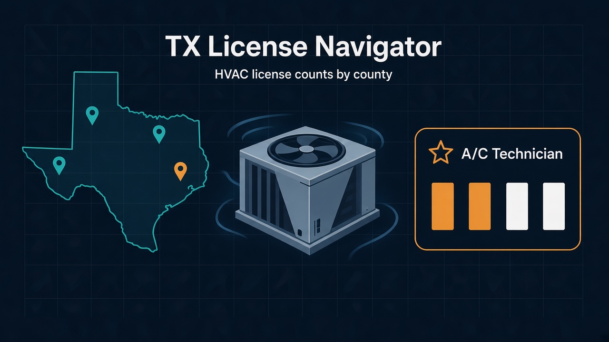
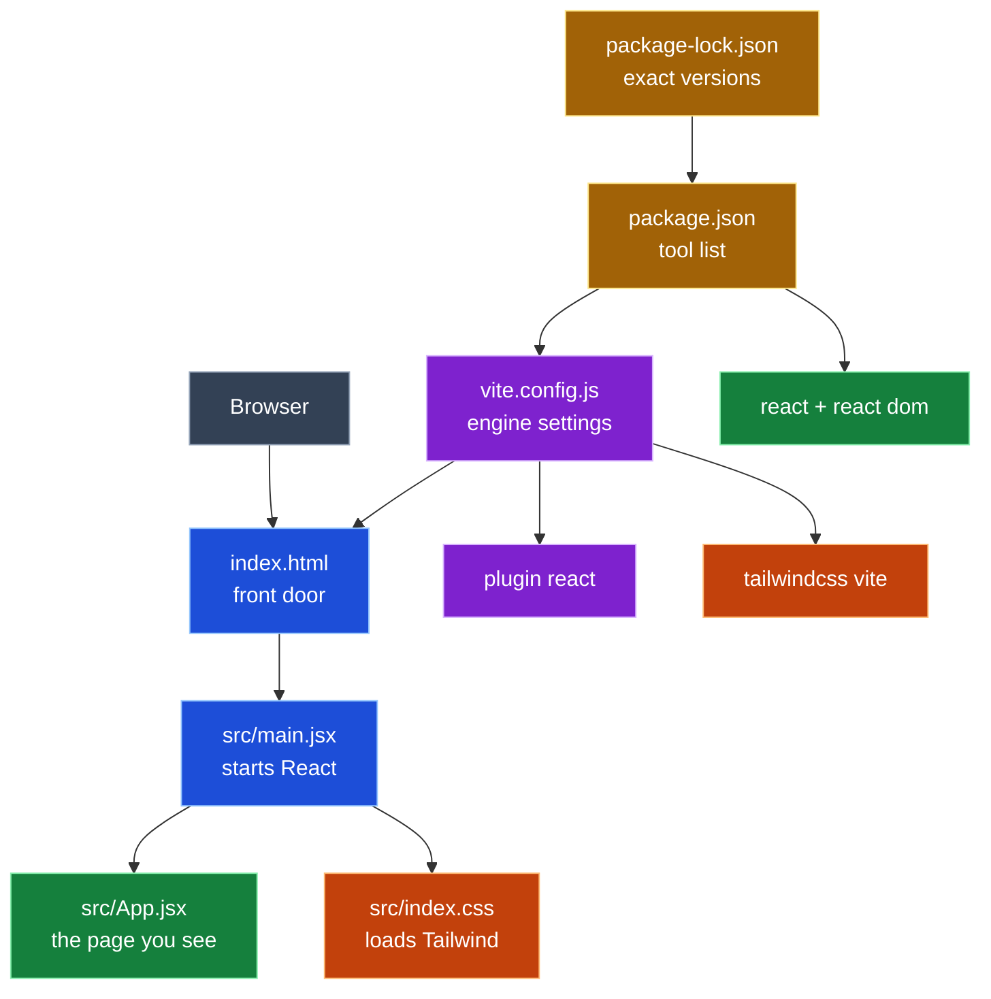
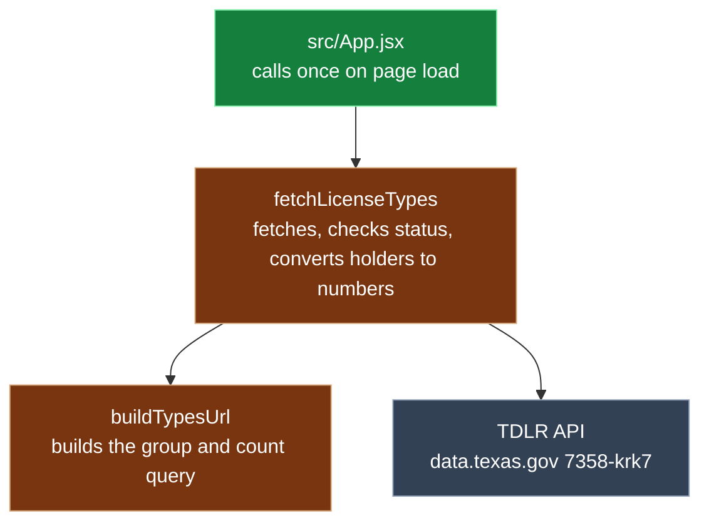
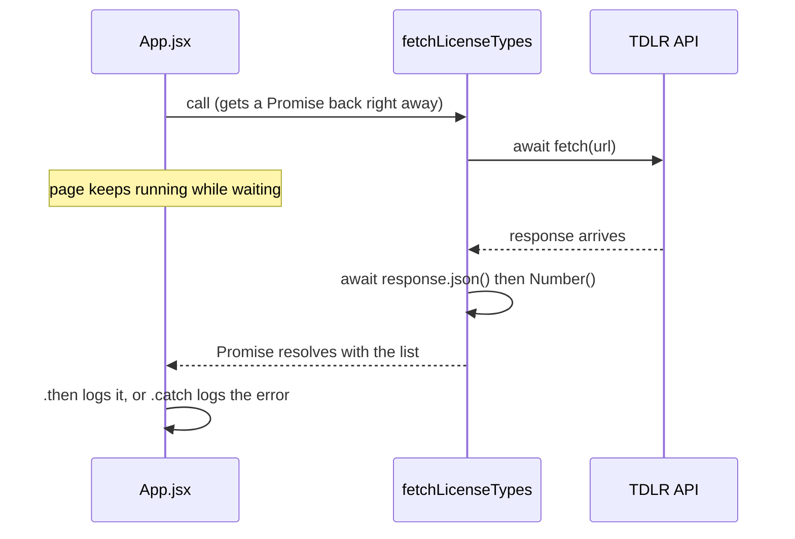
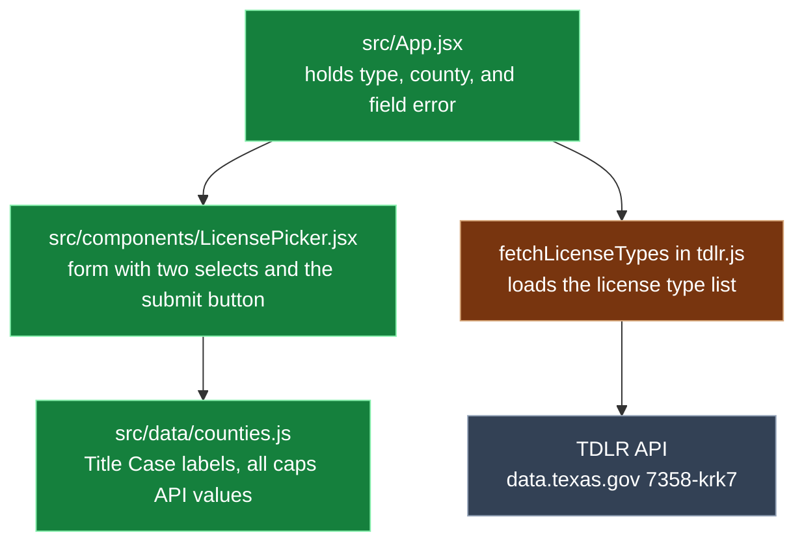

<h1 align="center">Prompt Log</h1>

<b>TX License Navigator</b> · Week 4 · Kiro CLI · claude-opus-5.5

---

## Legend

🟦 Entry (<code>index.html</code>, <code>src/main.jsx</code>) 
🟩 UI (<code>src/App.jsx</code>, <code>src/components/LicensePicker.jsx</code>, <code>src/data/counties.js</code>, <code>react</code>, <code>react-dom</code>) 
🟧 Style (<code>src/index.css</code>, <code>tailwindcss</code>, <code>@tailwindcss/vite</code>) 
🟪 Build tools (<code>vite.config.js</code>, <code>vite</code>, <code>@vitejs/plugin-react</code>) 
🟨 Dependencies (<code>package.json</code>, <code>package-lock.json</code>) 
🟫 API (<code>src/api/tdlr.js</code>)

---

## Project info

<table>
  <tr><th align="left">Field</th><th align="left">Details</th></tr>
  <tr><td><b>One liner</b></td><td></td></tr>
  <tr><td><b>Privacy</b></td><td>counts only, never a personal license row</td></tr>
  <tr><td><b>Tools</b></td><td>Kiro CLI · claude-opus-5.5</td></tr>
</table>

---

## Entry 1 · Warm up (read only)

*Oct 6 · 17:57 to ~18:03 CT*

<table>
  <tr><th align="left">Field</th><th align="left">Details</th></tr>
  <tr><td><b>Tool</b></td><td>Kiro CLI · claude-opus-5.5</td></tr>
  <tr><td><b>Asked</b></td><td>Read only: 5 bullets on project, tasks 1-6, privacy rules; list unclear or wrong spec items</td></tr>
  <tr><td><b>Context</b></td><td>
    <ul>
      <li>steering (4 always-on files)</li>
      <li><code>prompts.md</code></li>
      <li><code>requirements.md</code></li>
      <li><code>design.md</code></li>
      <li><code>tasks.md</code></li>
      <li><code>mvp-map.md</code></li>
      <li><code>ui-reference.md</code></li>
    </ul>
  </td></tr>
  <tr><td><b>Changed</b></td><td>no files · listed 7 spec issues</td></tr>
  <tr><td><b>Decision</b></td><td>n/a (read only)</td></tr>
  <tr><td><b>Verified</b></td><td>
    <ul>
      <li>~18:03 CT · curl A/C Technician + LOVING = 0</li>
      <li>~18:03 CT · curl A/C Contractor + LOVING = 0</li>
      <li>~18:03 CT · git status: not a git repo yet</li>
    </ul>
  </td></tr>
  <tr><td><b>Commit</b></td><td>none</td></tr>
  <tr><td><b>Reflection</b></td><td>I learned to load context before asking for code: steering, spec, then reference docs. I asked how # chips in the panel differ from @ tags in the CLI, and moved to the CLI after the panel crashed. The read only pass caught 7 unclear spec items before any code was written. I also learned git init has to come before the first commit, and that this assignment needs no branching, so I stayed on main.</td></tr>
  <tr><td><b>Explained</b></td><td>
    <b>Entry 1 · Warm up (nothing changed)</b>
    <ul>
      <li>What it is: the agent read the plan and told us what it thought we're building. It didn't write any code.</li>
      <li>Why: it's like reading the recipe before you cook. If the agent gets the plan wrong, every step after it comes out wrong too.</li>
      <li>What it found: 7 confusing spots in the plan, which we fixed before building anything.</li>
      <li>Its role in the project: it proves the agent understood the job. It's also your first piece of evidence that you checked the AI instead of just trusting it.</li>
    </ul>
  </td></tr>
</table>

---

## Entry 2 · Task 1 scaffold

*Oct 6 · 18:40 to 18:49 CT*

<table>
  <tr><th align="left">Field</th><th align="left">Details</th></tr>
  <tr><td><b>Tool</b></td><td>Kiro CLI · claude-opus-5.5</td></tr>
  <tr><td><b>Asked</b></td><td>Task 1 only: scaffold Vite + React + Tailwind, blank page runs. Show the diff and stop</td></tr>
  <tr><td><b>Context</b></td><td>same as Entry 1</td></tr>
  <tr><td><b>Changed</b></td><td>
    7 new files, written by hand (no scaffold tool)
    <ul>
      <li>🟨 <code>package.json</code></li>
      <li>🟨 <code>package-lock.json</code></li>
      <li>🟪 <code>vite.config.js</code></li>
      <li>🟦 <code>index.html</code></li>
      <li>🟦 <code>src/main.jsx</code></li>
      <li>🟧 <code>src/index.css</code></li>
      <li>🟩 <code>src/App.jsx</code></li>
    </ul>
    pinned: 🟩 <code>react</code> + 🟩 <code>react-dom</code> 19.3.0, 🟪 <code>vite</code> 8.3.3, 🟪 <code>@vitejs/plugin-react</code> 6.1.2, 🟧 <code>tailwindcss</code> + 🟧 <code>@tailwindcss/vite</code> 4.3.3 
    <code>.gitignore</code> unchanged (already had <code>.env</code>, <code>node_modules</code>, <code>dist</code>)
  </td></tr>
  <tr><td><b>Decision</b></td><td>accepted</td></tr>
  <tr><td><b>Verified</b></td><td>
    <ul>
      <li>by 18:49 CT · <code>npm install</code>, 0 vulnerabilities</li>
      <li>by 18:49 CT · <code>npm run build</code> passed</li>
      <li>by 18:49 CT · <code>text-3xl</code> found in built CSS</li>
    </ul>
  </td></tr>
  <tr><td><b>Commit</b></td><td><code>c3f0aad</code> chore: scaffold vite react tailwind</td></tr>
  <tr><td><b>Reflection</b></td><td>Before committing, I wanted to be sure only the right files got pushed, so I set up a grouped .gitignore that keeps secrets, node_modules, and builds out. I reviewed the diff before I accepted it and checked that the page loaded myself. I asked whether the log template matched the assignment and found the rewrite had dropped the lesson asks, so I added them back. Next time I want to read the diff more closely before I approve.</td></tr>
  <tr><td><b>Explained</b></td><td>
    <b>Entry 2 · Task 1 scaffold (7 new files)</b>
    <ul>
      <li>What it is: the empty house. There's no furniture yet, just walls and a roof that stand up.</li>
      <li>Files
        <ul>
          <li>🟨 <code>package.json</code> and 🟨 <code>package-lock.json</code> are the shopping list of tools (React, Vite, Tailwind) at exact versions</li>
          <li>🟪 <code>vite.config.js</code> holds the settings for the engine that runs your app</li>
          <li>🟦 <code>index.html</code> is the front door the browser opens</li>
          <li>🟦 <code>src/main.jsx</code> turns the lights on by starting React</li>
          <li>🟧 <code>src/index.css</code> brings in Tailwind so things can look nice</li>
          <li>🟩 <code>src/App.jsx</code> is the one room you see, with just a heading for now</li>
        </ul>
      </li>
      <li>Why: you need a house before you can put a picker or a count card in it.</li>
      <li>Its role in the project: every later step (the types list, the picker, the count, Clear) lives inside 🟩 <code>App.jsx</code> and builds on this base.</li>
    </ul>
  </td></tr>
</table>

### Entry 2 call graph

---

## Entry 3 · Task 2 fetch license types

*Oct 6 · 20:27 to 20:48 CT*

<table>
  <tr><th align="left">Field</th><th align="left">Details</th></tr>
  <tr><td><b>Tool</b></td><td>Kiro CLI · claude-opus-5.5</td></tr>
  <tr><td><b>Asked</b></td><td>Task 2 only: create 🟫 <code>src/api/tdlr.js</code> with <code>buildTypesUrl()</code> and <code>fetchLicenseTypes()</code>, log the list from 🟩 <code>src/App.jsx</code>. No UI, no packages</td></tr>
  <tr><td><b>Context</b></td><td>
    <ul>
      <li>steering (4 always-on files)</li>
      <li><code>tasks.md</code></li>
      <li><code>design.md</code></li>
      <li><code>mvp-map.md</code></li>
      <li>🟩 <code>src/App.jsx</code></li>
    </ul>
  </td></tr>
  <tr><td><b>Changed</b></td><td>
    1 new file, 1 edited
    <ul>
      <li>🟫 <code>src/api/tdlr.js</code> (new)</li>
      <li>🟩 <code>src/App.jsx</code> (modified)</li>
    </ul>
  </td></tr>
  <tr><td><b>Decision</b></td><td>accepted</td></tr>
  <tr><td><b>Verified</b></td><td>
    <ul>
      <li>~20:28 CT · <code>npm run build</code> passed</li>
      <li>by 20:48 CT · browser console showed 50 types, A/C Technician 60809 and A/C Contractor 20436 as numbers</li>
    </ul>
  </td></tr>
  <tr><td><b>Commit</b></td><td><code>5d1c56a</code> feat: fetch license types from TDLR</td></tr>
  <tr><td><b>Reflection</b></td><td>I learned that the prompt wasn't made up on the spot. It came from our planning, and this step tested whether that plan held up. I checked the diff against my Watch for list (await, no $select=*, Number(), URLSearchParams) before accepting. I learned that response.json() parses JSON text into a JavaScript value (the opposite of stringify), and that holders still comes back as a string, which is why Number() is needed. I verified it myself: the console showed 50 types with A/C Technician 60809 and A/C Contractor 20436 as numbers. I noticed the first draft exported quote(), but it was removed before the build. I checked the committed file with git show to confirm what actually shipped. I also learned I don't need Postman for simple public GET requests; the browser and curl are enough here. I learned that fetch() returns a Promise, a placeholder for an answer that hasn't arrived yet. async/await lets the code pause and wait for it without freezing the page. fetch and response.json() both return Promises, which is why both need await. In App.jsx, .then() runs when the Promise succeeds and .catch() runs when it fails.</td></tr>
  <tr><td><b>Explained</b></td><td>
    <b>Entry 3 · Task 2 fetch license types</b>
    <ul>
      <li>What it is: a messenger file (tdlr.js) that goes to the TDLR website and asks, "How many people hold each license?" App.jsx sends the messenger once when the page opens.</li>
      <li>Async: asking TDLR is like ordering food. You get a ticket (a Promise) right away, and the food comes later. "await" means wait for the food before eating. The page keeps working while it waits.</li>
      <li>Why: the app needs the real list of license types before it can show a picker in Step 3.</li>
      <li>Files
        <ul>
          <li>🟫 <code>tdlr.js</code>: builds the question (the URL), sends it, waits for the answer, turns the counts from words into numbers, and shouts if something breaks</li>
          <li>🟩 <code>App.jsx</code>: tells the messenger to go once and writes the answer in the console</li>
        </ul>
      </li>
      <li>Role in project: this is the pipe that brings real data into the app. The picker, the count card, and the error states all use it.</li>
    </ul>
  </td></tr>
</table>

### Entry 3 call graph

### Entry 3 async sequence

---

## Entry 4 · Task 3 license picker

*Oct 7 · by 20:53 CT*

<table>
  <tr><th align="left">Field</th><th align="left">Details</th></tr>
  <tr><td><b>Tool</b></td><td>Kiro CLI · claude-opus-5.5 · supervised</td></tr>
  <tr><td><b>Asked</b></td><td>"Go on task 3. Also tick tasks 1 and 2 in tasks.md. Counties display in Title Case but the value sent to the API must be the all caps business_county value. Supervised, show the diff, do not commit."</td></tr>
  <tr><td><b>Context</b></td><td>
    <ul>
      <li><code>tasks.md</code> task 3</li>
      <li>🟫 <code>src/api/tdlr.js</code></li>
      <li>verified fact: <code>business_county</code> values are all caps</li>
    </ul>
  </td></tr>
  <tr><td><b>Changed</b></td><td>
    2 new files, 1 edited
    <ul>
      <li>🟩 <code>src/App.jsx</code> (modified)</li>
      <li>🟩 <code>src/components/LicensePicker.jsx</code> (new)</li>
      <li>🟩 <code>src/data/counties.js</code> (new)</li>
    </ul>
  </td></tr>
  <tr><td><b>Decision</b></td><td>
    <ul>
      <li>keep Loving as the empty state test case</li>
      <li>keep A/C CE Provider out of the HVAC group</li>
      <li>send county values in caps</li>
    </ul>
  </td></tr>
  <tr><td><b>Verified</b></td><td>
    <ul>
      <li>~20:50 CT · <code>npm run build</code> passed</li>
      <li>~20:50 CT · no <code>console.log</code> in <code>src/</code></li>
      <li>~20:50 CT · curl: all 13 county values exist in the live API</li>
      <li>~20:50 CT · curl A/C Technician + LOVING = 0</li>
      <li>~20:50 CT · curl: A/C CE Provider is a real type, kept out of the HVAC group by exact match</li>
    </ul>
  </td></tr>
  <tr><td><b>Commit</b></td><td><code>3c6d7ae</code> feat: license picker from live TDLR data</td></tr>
  <tr><td><b>Reflection</b></td><td>I built the license picker so the job list comes from live TDLR data, not a typed list. I proved it by blocking the API call in DevTools and watching the job box go empty. My first Offline test failed because it blocked my own page too, so I learned to block only the one request. Kiro deleted the dist folder against the rules and told me about it, which led me to add a report format so problems always show up in their own section.</td></tr>
  <tr><td><b>Explained</b></td><td>The app has two boxes, one for the job and one for the county. When the page opens, it asks Texas's website for the job list, so the list is always real. Counties show up nicely, like "Harris," but the app sends "HARRIS" because that's how the data stores them. If you click without picking a county, the app asks you to choose one first.</td></tr>
</table>

### Entry 4 call graph

---

## Lesson asks

<table>
  <tr><th align="left">Day</th><th align="left">Details</th></tr>
  <tr><td><b>Day 1</b></td><td>commands learned, two commit messages</td></tr>
  <tr><td><b>Day 2</b></td><td>accepted and rejected prompts, Exploration 3</td></tr>
  <tr><td><b>Day 3</b></td><td>three APIs and data labels, project one liner</td></tr>
</table>

---

## Friday submit

<table>
  <tr><th align="left">Field</th><th align="left">Details</th></tr>
  <tr><td><b>Change I will explain</b></td><td></td></tr>
  <tr><td><b>Mistake I caught</b></td><td></td></tr>
</table>
