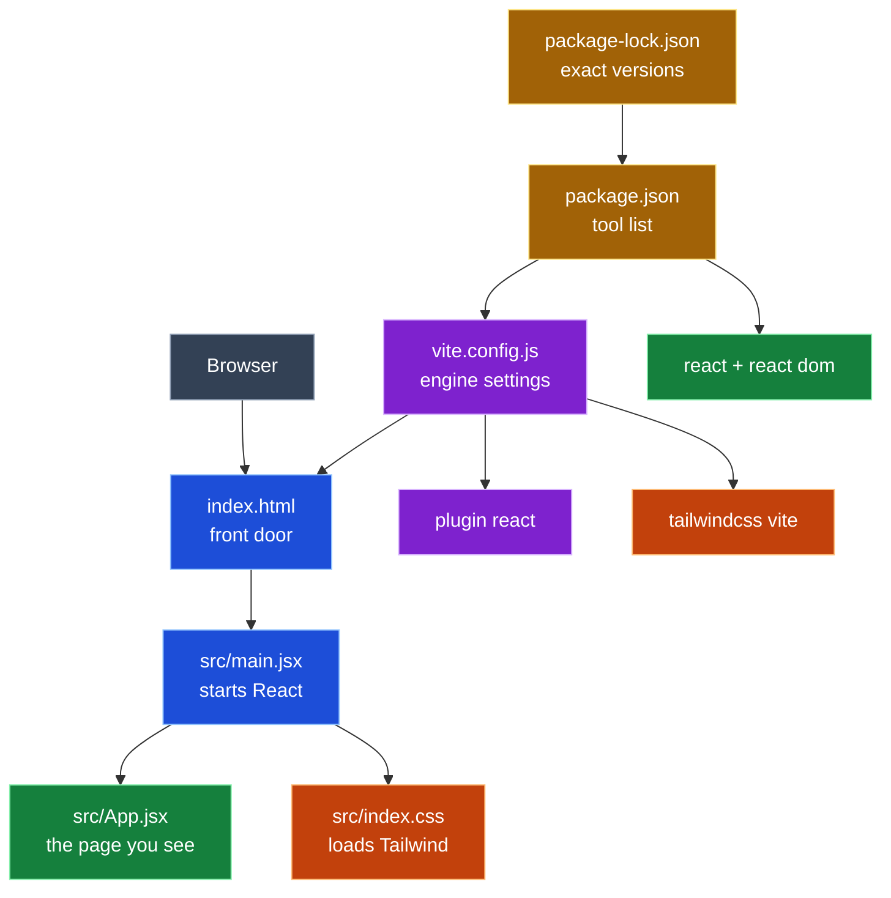

<h1 align="center">Prompt Log</h1>

<b>TX License Navigator</b> · Week 4 · Kiro CLI · claude-opus-5.5

---

## Legend

🟦 Entry (<code>index.html</code>, <code>src/main.jsx</code>) 
🟩 UI (<code>src/App.jsx</code>, <code>react</code>, <code>react-dom</code>) 
🟧 Style (<code>src/index.css</code>, <code>tailwindcss</code>, <code>@tailwindcss/vite</code>) 
🟪 Build tools (<code>vite.config.js</code>, <code>vite</code>, <code>@vitejs/plugin-react</code>) 
🟨 Dependencies (<code>package.json</code>, <code>package-lock.json</code>)

---

## Project info

<table>
  <tr><th align="left">Field</th><th align="left">Details</th></tr>
  <tr><td><b>One liner</b></td><td></td></tr>
  <tr><td><b>Privacy</b></td><td>counts only, never a personal license row</td></tr>
  <tr><td><b>Tools</b></td><td>Kiro CLI · claude-opus-5.5</td></tr>
</table>

---

## Entry 1 · Warm up (read only)

*Oct 6 · 17:57 to ~18:03 CT*

<table>
  <tr><th align="left">Field</th><th align="left">Details</th></tr>
  <tr><td><b>Tool</b></td><td>Kiro CLI · claude-opus-5.5</td></tr>
  <tr><td><b>Asked</b></td><td>Read only: 5 bullets on project, tasks 1-6, privacy rules; list unclear or wrong spec items</td></tr>
  <tr><td><b>Context</b></td><td>
    <ul>
      <li>steering (4 always-on files)</li>
      <li><code>prompts.md</code></li>
      <li><code>requirements.md</code></li>
      <li><code>design.md</code></li>
      <li><code>tasks.md</code></li>
      <li><code>mvp-map.md</code></li>
      <li><code>ui-reference.md</code></li>
    </ul>
  </td></tr>
  <tr><td><b>Changed</b></td><td>no files · listed 7 spec issues</td></tr>
  <tr><td><b>Decision</b></td><td>n/a (read only)</td></tr>
  <tr><td><b>Verified</b></td><td>
    <ul>
      <li>~18:03 CT · curl A/C Technician + LOVING = 0</li>
      <li>~18:03 CT · curl A/C Contractor + LOVING = 0</li>
      <li>~18:03 CT · git status: not a git repo yet</li>
    </ul>
  </td></tr>
  <tr><td><b>Commit</b></td><td>none</td></tr>
  <tr><td><b>Reflection</b></td><td>I learned to load context before asking for code: steering, spec, then reference docs. I asked how # chips in the panel differ from @ tags in the CLI, and moved to the CLI after the panel crashed. The read only pass caught 7 unclear spec items before any code was written. I also learned git init has to come before the first commit, and that this assignment needs no branching, so I stayed on main.</td></tr>
  <tr><td><b>Explained</b></td><td>
    <b>Entry 1 · Warm up (nothing changed)</b>
    <ul>
      <li>What it is: the agent read the plan and told us what it thought we're building. It didn't write any code.</li>
      <li>Why: it's like reading the recipe before you cook. If the agent gets the plan wrong, every step after it comes out wrong too.</li>
      <li>What it found: 7 confusing spots in the plan, which we fixed before building anything.</li>
      <li>Its role in the project: it proves the agent understood the job. It's also your first piece of evidence that you checked the AI instead of just trusting it.</li>
    </ul>
  </td></tr>
</table>

---

## Entry 2 · Task 1 scaffold

*Oct 6 · 18:40 to 18:49 CT*

<table>
  <tr><th align="left">Field</th><th align="left">Details</th></tr>
  <tr><td><b>Tool</b></td><td>Kiro CLI · claude-opus-5.5</td></tr>
  <tr><td><b>Asked</b></td><td>Task 1 only: scaffold Vite + React + Tailwind, blank page runs. Show the diff and stop</td></tr>
  <tr><td><b>Context</b></td><td>same as Entry 1</td></tr>
  <tr><td><b>Changed</b></td><td>
    7 new files, written by hand (no scaffold tool)
    <ul>
      <li>🟨 <code>package.json</code></li>
      <li>🟨 <code>package-lock.json</code></li>
      <li>🟪 <code>vite.config.js</code></li>
      <li>🟦 <code>index.html</code></li>
      <li>🟦 <code>src/main.jsx</code></li>
      <li>🟧 <code>src/index.css</code></li>
      <li>🟩 <code>src/App.jsx</code></li>
    </ul>
    pinned: 🟩 <code>react</code> + 🟩 <code>react-dom</code> 19.3.0, 🟪 <code>vite</code> 8.3.3, 🟪 <code>@vitejs/plugin-react</code> 6.1.2, 🟧 <code>tailwindcss</code> + 🟧 <code>@tailwindcss/vite</code> 4.3.3 
    <code>.gitignore</code> unchanged (already had <code>.env</code>, <code>node_modules</code>, <code>dist</code>)
  </td></tr>
  <tr><td><b>Decision</b></td><td>accepted</td></tr>
  <tr><td><b>Verified</b></td><td>
    <ul>
      <li>by 18:49 CT · <code>npm install</code>, 0 vulnerabilities</li>
      <li>by 18:49 CT · <code>npm run build</code> passed</li>
      <li>by 18:49 CT · <code>text-3xl</code> found in built CSS</li>
    </ul>
  </td></tr>
  <tr><td><b>Commit</b></td><td><code>c3f0aad</code> chore: scaffold vite react tailwind</td></tr>
  <tr><td><b>Reflection</b></td><td>Before committing, I wanted to be sure only the right files got pushed, so I set up a grouped .gitignore that keeps secrets, node_modules, and builds out. I reviewed the diff before I accepted it and checked that the page loaded myself. I asked whether the log template matched the assignment and found the rewrite had dropped the lesson asks, so I added them back. Next time I want to read the diff more closely before I approve.</td></tr>
  <tr><td><b>Explained</b></td><td>
    <b>Entry 2 · Task 1 scaffold (7 new files)</b>
    <ul>
      <li>What it is: the empty house. There's no furniture yet, just walls and a roof that stand up.</li>
      <li>Files
        <ul>
          <li>🟨 <code>package.json</code> and 🟨 <code>package-lock.json</code> are the shopping list of tools (React, Vite, Tailwind) at exact versions</li>
          <li>🟪 <code>vite.config.js</code> holds the settings for the engine that runs your app</li>
          <li>🟦 <code>index.html</code> is the front door the browser opens</li>
          <li>🟦 <code>src/main.jsx</code> turns the lights on by starting React</li>
          <li>🟧 <code>src/index.css</code> brings in Tailwind so things can look nice</li>
          <li>🟩 <code>src/App.jsx</code> is the one room you see, with just a heading for now</li>
        </ul>
      </li>
      <li>Why: you need a house before you can put a picker or a count card in it.</li>
      <li>Its role in the project: every later step (the types list, the picker, the count, Clear) lives inside 🟩 <code>App.jsx</code> and builds on this base.</li>
    </ul>
  </td></tr>
</table>

### Entry 2 call graph

---

## Lesson asks

<table>
  <tr><th align="left">Day</th><th align="left">Details</th></tr>
  <tr><td><b>Day 1</b></td><td>commands learned, two commit messages</td></tr>
  <tr><td><b>Day 2</b></td><td>accepted and rejected prompts, Exploration 3</td></tr>
  <tr><td><b>Day 3</b></td><td>three APIs and data labels, project one liner</td></tr>
</table>

---

## Friday submit

<table>
  <tr><th align="left">Field</th><th align="left">Details</th></tr>
  <tr><td><b>Change I will explain</b></td><td></td></tr>
  <tr><td><b>Mistake I caught</b></td><td></td></tr>
</table>
