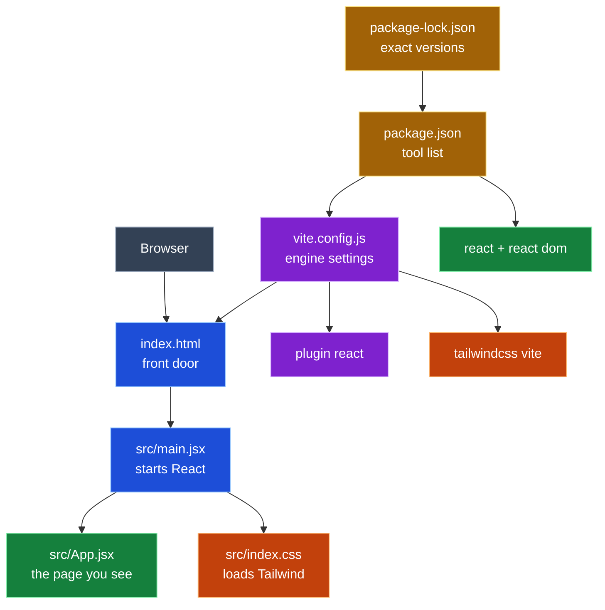
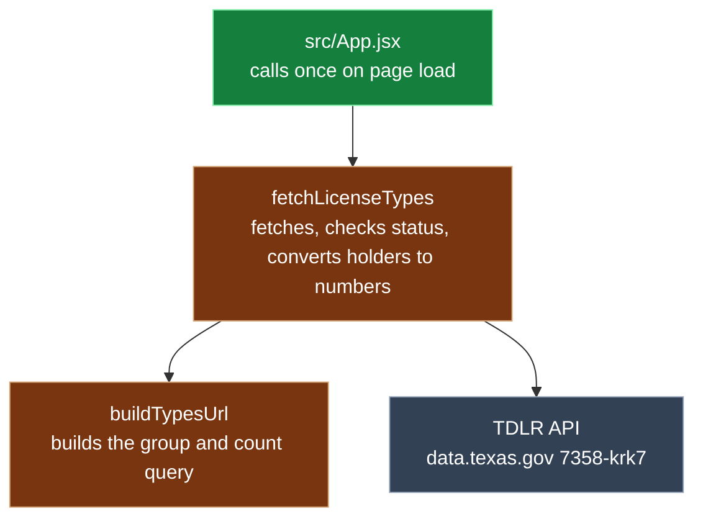
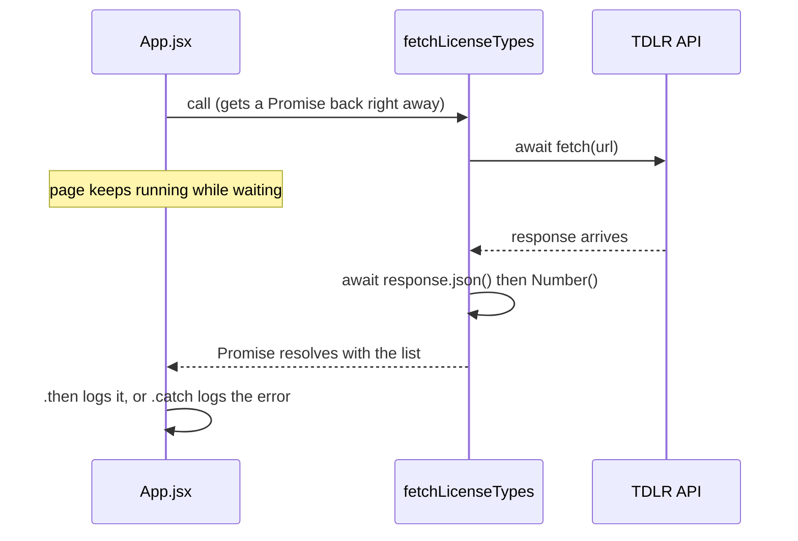
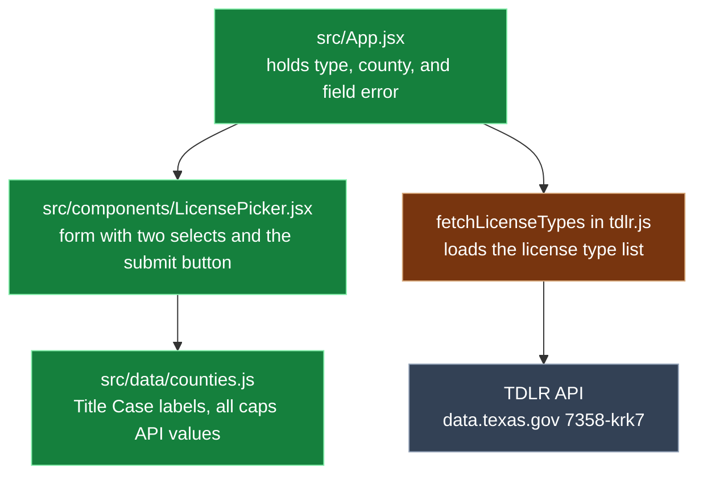
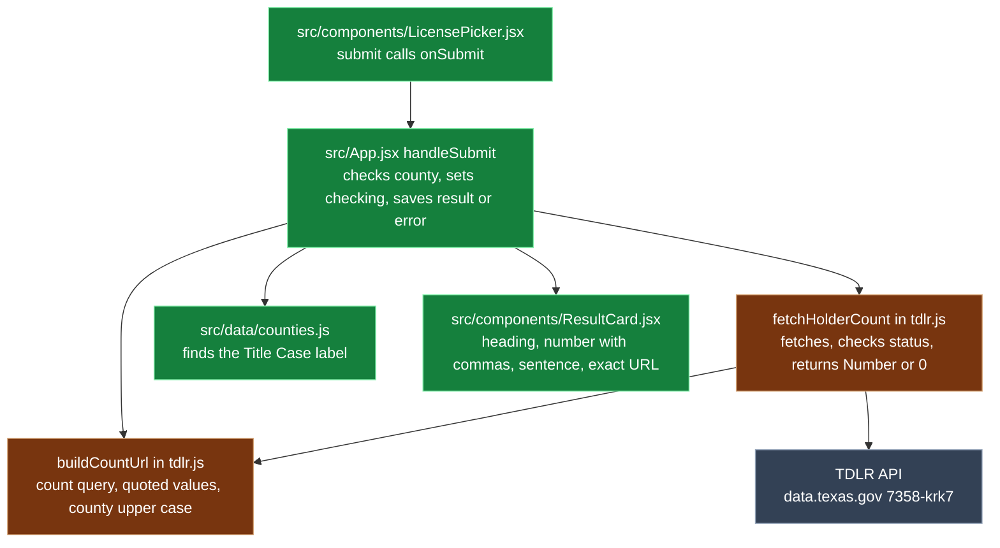
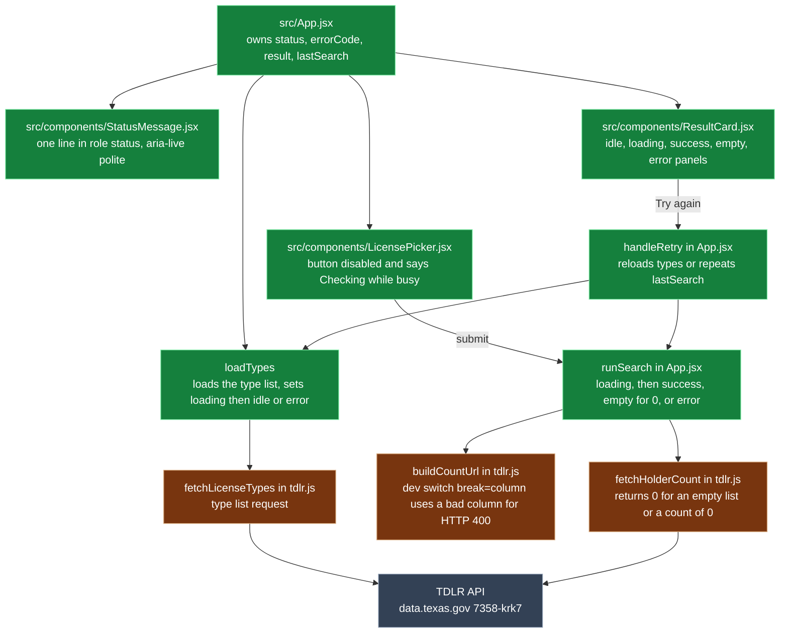
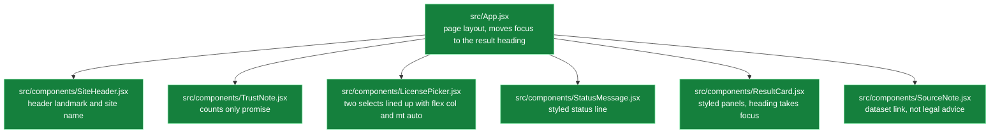

<h1 align="center">Prompt Log</h1>

<b>TX License Navigator</b> · Week 4 · Kiro CLI · claude-opus-5.5

---

## Legend

🟦 Entry (<code>index.html</code>, <code>src/main.jsx</code>) 
🟩 UI (<code>src/App.jsx</code>, <code>src/components/LicensePicker.jsx</code>, <code>src/data/counties.js</code>, <code>src/components/ResultCard.jsx</code>, <code>src/components/StatusMessage.jsx</code>, <code>react</code>, <code>react-dom</code>) 
🟧 Style (<code>src/index.css</code>, <code>tailwindcss</code>, <code>@tailwindcss/vite</code>) 
🟪 Build tools (<code>vite.config.js</code>, <code>vite</code>, <code>@vitejs/plugin-react</code>) 
🟨 Dependencies (<code>package.json</code>, <code>package-lock.json</code>) 
🟫 API (<code>src/api/tdlr.js</code>)

---

## Project info

<table>
  <tr><th align="left">Field</th><th align="left">Details</th></tr>
  <tr><td><b>One liner</b></td><td>Second Chance License Navigator shows how many people hold an HVAC license in any Texas county, using live TDLR data, so job seekers can judge local demand before they train.</td></tr>
  <tr><td><b>Privacy</b></td><td>counts only, never a personal license row</td></tr>
  <tr><td><b>Tools</b></td><td>Kiro CLI · claude-opus-5.5</td></tr>
</table>

---

## Entry 1 · Warm up (read only)

*Oct 6 · 17:57 to ~18:03 CT*

<table>
  <tr><th align="left">Field</th><th align="left">Details</th></tr>
  <tr><td><b>Tool</b></td><td>Kiro CLI · claude-opus-5.5</td></tr>
  <tr><td><b>Asked</b></td><td>Read only: 5 bullets on project, tasks 1-6, privacy rules; list unclear or wrong spec items</td></tr>
  <tr><td><b>Context</b></td><td>
    <ul>
      <li>steering (4 always-on files)</li>
      <li><code>prompts.md</code></li>
      <li><code>requirements.md</code></li>
      <li><code>design.md</code></li>
      <li><code>tasks.md</code></li>
      <li><code>mvp-map.md</code></li>
      <li><code>ui-reference.md</code></li>
    </ul>
  </td></tr>
  <tr><td><b>Changed</b></td><td>no files · listed 7 spec issues</td></tr>
  <tr><td><b>Decision</b></td><td>n/a (read only)</td></tr>
  <tr><td><b>Verified</b></td><td>
    <ul>
      <li>~18:03 CT · curl A/C Technician + LOVING = 0</li>
      <li>~18:03 CT · curl A/C Contractor + LOVING = 0</li>
      <li>~18:03 CT · git status: not a git repo yet</li>
    </ul>
  </td></tr>
  <tr><td><b>Commit</b></td><td>none</td></tr>
  <tr><td><b>Reflection</b></td><td>
    <ul>
      <li>I learned to load context before asking for code: steering, spec, then reference docs.</li>
      <li>I asked how # chips in the panel differ from @ tags in the CLI, and moved to the CLI after the panel crashed.</li>
      <li>The read only pass caught 7 unclear spec items before any code was written.</li>
      <li>I also learned git init has to come before the first commit, and that this assignment needs no branching, so I stayed on main.</li>
    </ul>
  </td></tr>
  <tr><td><b>Explained</b></td><td>
    <b>Entry 1 · Warm up (nothing changed)</b>
    <ul>
      <li>What it is: the agent read the plan and told us what it thought we're building. It didn't write any code.</li>
      <li>Why: it's like reading the recipe before you cook. If the agent gets the plan wrong, every step after it comes out wrong too.</li>
      <li>What it found: 7 confusing spots in the plan, which we fixed before building anything.</li>
      <li>Its role in the project: it proves the agent understood the job. It's also your first piece of evidence that you checked the AI instead of just trusting it.</li>
    </ul>
  </td></tr>
</table>

---

## Entry 2 · Task 1 scaffold

*Oct 6 · 18:40 to 18:49 CT*

<table>
  <tr><th align="left">Field</th><th align="left">Details</th></tr>
  <tr><td><b>Tool</b></td><td>Kiro CLI · claude-opus-5.5</td></tr>
  <tr><td><b>Asked</b></td><td>Task 1 only: scaffold Vite + React + Tailwind, blank page runs. Show the diff and stop</td></tr>
  <tr><td><b>Context</b></td><td>same as Entry 1</td></tr>
  <tr><td><b>Changed</b></td><td>
    7 new files, written by hand (no scaffold tool)
    <ul>
      <li>🟨 <code>package.json</code></li>
      <li>🟨 <code>package-lock.json</code></li>
      <li>🟪 <code>vite.config.js</code></li>
      <li>🟦 <code>index.html</code></li>
      <li>🟦 <code>src/main.jsx</code></li>
      <li>🟧 <code>src/index.css</code></li>
      <li>🟩 <code>src/App.jsx</code></li>
    </ul>
    pinned: 🟩 <code>react</code> + 🟩 <code>react-dom</code> 19.3.0, 🟪 <code>vite</code> 8.3.3, 🟪 <code>@vitejs/plugin-react</code> 6.1.2, 🟧 <code>tailwindcss</code> + 🟧 <code>@tailwindcss/vite</code> 4.3.3 
    <code>.gitignore</code> unchanged (already had <code>.env</code>, <code>node_modules</code>, <code>dist</code>)
  </td></tr>
  <tr><td><b>Decision</b></td><td>accepted</td></tr>
  <tr><td><b>Verified</b></td><td>
    <ul>
      <li>by 18:49 CT · <code>npm install</code>, 0 vulnerabilities</li>
      <li>by 18:49 CT · <code>npm run build</code> passed</li>
      <li>by 18:49 CT · <code>text-3xl</code> found in built CSS</li>
    </ul>
  </td></tr>
  <tr><td><b>Commit</b></td><td><code>c3f0aad</code> chore: scaffold vite react tailwind</td></tr>
  <tr><td><b>Reflection</b></td><td>
    <ul>
      <li>Before committing, I wanted to be sure only the right files got pushed, so I set up a grouped <code>.gitignore</code> that keeps secrets, <code>node_modules</code>, and builds out.</li>
      <li>I reviewed the diff before I accepted it and checked that the page loaded myself.</li>
      <li>I asked whether the log template matched the assignment and found the rewrite had dropped the lesson asks, so I added them back.</li>
      <li>Next time I want to read the diff more closely before I approve.</li>
    </ul>
  </td></tr>
  <tr><td><b>Explained</b></td><td>
    <b>Entry 2 · Task 1 scaffold (7 new files)</b>
    <ul>
      <li>What it is: the empty house. There's no furniture yet, just walls and a roof that stand up.</li>
      <li>Files
        <ul>
          <li>🟨 <code>package.json</code> and 🟨 <code>package-lock.json</code> are the shopping list of tools (React, Vite, Tailwind) at exact versions</li>
          <li>🟪 <code>vite.config.js</code> holds the settings for the engine that runs your app</li>
          <li>🟦 <code>index.html</code> is the front door the browser opens</li>
          <li>🟦 <code>src/main.jsx</code> turns the lights on by starting React</li>
          <li>🟧 <code>src/index.css</code> brings in Tailwind so things can look nice</li>
          <li>🟩 <code>src/App.jsx</code> is the one room you see, with just a heading for now</li>
        </ul>
      </li>
      <li>Why: you need a house before you can put a picker or a count card in it.</li>
      <li>Its role in the project: every later step (the types list, the picker, the count, Clear) lives inside 🟩 <code>App.jsx</code> and builds on this base.</li>
    </ul>
  </td></tr>
</table>

### Entry 2 call graph

---

## Entry 3 · Task 2 fetch license types

*Oct 6 · 20:27 to 20:48 CT*

<table>
  <tr><th align="left">Field</th><th align="left">Details</th></tr>
  <tr><td><b>Tool</b></td><td>Kiro CLI · claude-opus-5.5</td></tr>
  <tr><td><b>Asked</b></td><td>Task 2 only: create 🟫 <code>src/api/tdlr.js</code> with <code>buildTypesUrl()</code> and <code>fetchLicenseTypes()</code>, log the list from 🟩 <code>src/App.jsx</code>. No UI, no packages</td></tr>
  <tr><td><b>Context</b></td><td>
    <ul>
      <li>steering (4 always-on files)</li>
      <li><code>tasks.md</code></li>
      <li><code>design.md</code></li>
      <li><code>mvp-map.md</code></li>
      <li>🟩 <code>src/App.jsx</code></li>
    </ul>
  </td></tr>
  <tr><td><b>Changed</b></td><td>
    1 new file, 1 edited
    <ul>
      <li>🟫 <code>src/api/tdlr.js</code> (new)</li>
      <li>🟩 <code>src/App.jsx</code> (modified)</li>
    </ul>
  </td></tr>
  <tr><td><b>Decision</b></td><td>accepted</td></tr>
  <tr><td><b>Verified</b></td><td>
    <ul>
      <li>~20:28 CT · <code>npm run build</code> passed</li>
      <li>by 20:48 CT · browser console showed 50 types, A/C Technician 60809 and A/C Contractor 20436 as numbers</li>
    </ul>
  </td></tr>
  <tr><td><b>Commit</b></td><td><code>5d1c56a</code> feat: fetch license types from TDLR</td></tr>
  <tr><td><b>Reflection</b></td><td>
    <ul>
      <li>I learned that the prompt wasn't made up on the spot. It came from our planning, and this step tested whether that plan held up.</li>
      <li>I checked the diff against my Watch for list (await, no $select=*, Number(), URLSearchParams) before accepting.</li>
      <li>I learned that response.json() parses JSON text into a JavaScript value (the opposite of stringify), and that holders still comes back as a string, which is why Number() is needed.</li>
      <li>I verified it myself: the console showed 50 types with A/C Technician 60809 and A/C Contractor 20436 as numbers.</li>
      <li>I noticed the first draft exported quote(), but it was removed before the build. I checked the committed file with git show to confirm what actually shipped.</li>
      <li>I also learned I don't need Postman for simple public GET requests; the browser and curl are enough here.</li>
      <li>I learned that fetch() returns a Promise, a placeholder for an answer that hasn't arrived yet. async/await lets the code pause and wait for it without freezing the page. fetch and response.json() both return Promises, which is why both need await. In 🟩 <code>App.jsx</code>, .then() runs when the Promise succeeds and .catch() runs when it fails.</li>
    </ul>
  </td></tr>
  <tr><td><b>Explained</b></td><td>
    <b>Entry 3 · Task 2 fetch license types</b>
    <ul>
      <li>What it is: a messenger file (tdlr.js) that goes to the TDLR website and asks, "How many people hold each license?" App.jsx sends the messenger once when the page opens.</li>
      <li>Async: asking TDLR is like ordering food. You get a ticket (a Promise) right away, and the food comes later. "await" means wait for the food before eating. The page keeps working while it waits.</li>
      <li>Why: the app needs the real list of license types before it can show a picker in Step 3.</li>
      <li>Files
        <ul>
          <li>🟫 <code>tdlr.js</code>: builds the question (the URL), sends it, waits for the answer, turns the counts from words into numbers, and shouts if something breaks</li>
          <li>🟩 <code>App.jsx</code>: tells the messenger to go once and writes the answer in the console</li>
        </ul>
      </li>
      <li>Role in project: this is the pipe that brings real data into the app. The picker, the count card, and the error states all use it.</li>
    </ul>
  </td></tr>
</table>

### Entry 3 call graph

### Entry 3 async sequence

---

## Entry 4 · Task 3 license picker

*Oct 7 · by 20:53 CT*

<table>
  <tr><th align="left">Field</th><th align="left">Details</th></tr>
  <tr><td><b>Tool</b></td><td>Kiro CLI · claude-opus-5.5 · supervised</td></tr>
  <tr><td><b>Asked</b></td><td>"Go on task 3. Also tick tasks 1 and 2 in tasks.md. Counties display in Title Case but the value sent to the API must be the all caps business_county value. Supervised, show the diff, do not commit."</td></tr>
  <tr><td><b>Context</b></td><td>
    <ul>
      <li><code>tasks.md</code> task 3</li>
      <li>🟫 <code>src/api/tdlr.js</code></li>
      <li>verified fact: <code>business_county</code> values are all caps</li>
    </ul>
  </td></tr>
  <tr><td><b>Changed</b></td><td>
    2 new files, 1 edited
    <ul>
      <li>🟩 <code>src/App.jsx</code> (modified)</li>
      <li>🟩 <code>src/components/LicensePicker.jsx</code> (new)</li>
      <li>🟩 <code>src/data/counties.js</code> (new)</li>
    </ul>
  </td></tr>
  <tr><td><b>Decision</b></td><td>
    <ul>
      <li>keep Loving as the empty state test case</li>
      <li>keep A/C CE Provider out of the HVAC group</li>
      <li>send county values in caps</li>
    </ul>
  </td></tr>
  <tr><td><b>Verified</b></td><td>
    <ul>
      <li>~20:50 CT · <code>npm run build</code> passed</li>
      <li>~20:50 CT · no <code>console.log</code> in <code>src/</code></li>
      <li>~20:50 CT · curl: all 13 county values exist in the live API</li>
      <li>~20:50 CT · curl A/C Technician + LOVING = 0</li>
      <li>~20:50 CT · curl: A/C CE Provider is a real type, kept out of the HVAC group by exact match</li>
    </ul>
  </td></tr>
  <tr><td><b>Commit</b></td><td><code>3c6d7ae</code> feat: license picker from live TDLR data</td></tr>
  <tr><td><b>Reflection</b></td><td>
    <ul>
      <li>I built the license picker so the job list comes from live TDLR data, not a typed list.</li>
      <li>I proved it by blocking the API call in DevTools and watching the job box go empty. My first Offline test failed because it blocked my own page too, so I learned to block only the one request.</li>
      <li>Kiro deleted the <code>dist</code> folder against the rules and told me about it, which led me to add a report format so problems always show up in their own section.</li>
    </ul>
  </td></tr>
  <tr><td><b>Explained</b></td><td>
    <ul>
      <li>The app has two boxes, one for the job and one for the county.</li>
      <li>When the page opens, it asks Texas's website for the job list, so the list is always real.</li>
      <li>Counties show up nicely, like "Harris," but the app sends "HARRIS" because that's how the data stores them.</li>
      <li>If you click without picking a county, the app asks you to choose one first.</li>
    </ul>
  </td></tr>
</table>

### Entry 4 call graph

---

## Entry 5 · Task 4 holder count and result card

*Oct 8 · ~12:30 to ~12:50 CT*

<table>
  <tr><th align="left">Field</th><th align="left">Details</th></tr>
  <tr><td><b>Tool</b></td><td>Kiro CLI · claude-opus-5.5 · supervised</td></tr>
  <tr><td><b>Asked</b></td><td>Full Step 4 prompt from <code>docs/prompts.md</code>. Task 4 only: <code>buildCountUrl</code> and <code>fetchHolderCount</code> in 🟫 <code>src/api/tdlr.js</code>, new 🟩 <code>src/components/ResultCard.jsx</code>, wire submit in 🟩 <code>src/App.jsx</code> with "Checking…". Stop after the diff, no commit</td></tr>
  <tr><td><b>Context</b></td><td>
    <ul>
      <li>steering (always on files)</li>
      <li><code>requirements.md</code></li>
      <li><code>design.md</code></li>
      <li><code>tasks.md</code></li>
      <li><code>mvp-map.md</code></li>
      <li><code>ui-reference.md</code></li>
    </ul>
  </td></tr>
  <tr><td><b>Changed</b></td><td>
    1 new file, 2 edited · 96 insertions, 4 deletions
    <ul>
      <li>🟫 <code>src/api/tdlr.js</code> (modified)</li>
      <li>🟩 <code>src/components/ResultCard.jsx</code> (new)</li>
      <li>🟩 <code>src/App.jsx</code> (modified)</li>
    </ul>
  </td></tr>
  <tr><td><b>Decision</b></td><td>accepted, with one deviation Kiro flagged under Problems: one result object (type, county, count, URL) instead of separate <code>count</code> and <code>lastQueryUrl</code> state from <code>design.md</code>. Accepted so the heading and number always describe the same search</td></tr>
  <tr><td><b>Verified</b></td><td>
    <ul>
      <li>by 12:39 CT · <code>npm run build</code> passed</li>
      <li>~12:48 CT · app card showed 12,095 for A/C Technician in Harris</li>
      <li>~12:49 CT · URL in the card matched the URL Kiro printed</li>
      <li>~12:50 CT · browser JSON returned holders "12095"</li>
    </ul>
  </td></tr>
  <tr><td><b>Commit</b></td><td><code>8d3db72</code> feat: holder count and result card</td></tr>
  <tr><td><b>Reflection</b></td><td>
    <ul>
      <li>This time I followed the guide: a fresh session, the full Step 4 prompt from <code>prompts.md</code>, and the five spec and reference files attached with @ tags. In Step 3 I had used a short prompt. Kiro stopped after the diff and did not commit.</li>
      <li>Because of my report format, it flagged its own deviation under Problems. The design called for separate count and lastQueryUrl state, but Kiro used one result bundle holding the type, county, count, and URL. I did not like that it went off spec, so I had the choice broken down in plain words before deciding. With separate state, the heading reads the dropdowns. If I searched Harris and then switched to Dallas, Harris's number would sit under a Dallas label. The bundle keeps each search's label and number together, so I accepted it.</li>
      <li>I still wanted the spec to match the code, so I updated <code>design.md</code> in its own commit. When I did, Kiro also flagged that the county row said Title Case while the code stores the all caps value, so I had that fixed too. I left the success row for task 5.</li>
      <li>I verified it myself: the card showed 12,095, the URL in the card matched the one Kiro printed, and the browser JSON returned "12095" as a string. That showed Number() and toLocaleString() did their jobs.</li>
      <li>I used my outside assistant for the step plan and to explain Kiro's choice, then made the call myself.</li>
    </ul>
  </td></tr>
  <tr><td><b>Explained</b></td><td>
    <b>Entry 5 · Task 4 holder count and result card</b>
    <ul>
      <li>What it is: the app finally answers the question. You pick a job and a county, press the button, and a card shows how many people hold that license there.</li>
      <li>The bundle: when an answer comes back, the app packs the job, county, number, and link into one box and shows that box. It's like a receipt: it shows what you ordered, even if you start looking at the menu again.</li>
      <li>Why: before this, the picker had nothing to show. Now the count is the main result of the whole app.</li>
      <li>Files:
        <ul>
          <li>🟫 <code>tdlr.js</code> builds the count question, sends it, and turns the answer from text into a number.</li>
          <li>🟩 <code>ResultCard.jsx</code> is the card: heading, big number with a comma, the reminder that a count is not a job listing, and the exact link used.</li>
          <li>🟩 <code>App.jsx</code> connects the button to the fetch, shows "Checking…" while waiting, and keeps the bundle.</li>
        </ul>
      </li>
    </ul>
  </td></tr>
</table>

### Entry 5 call graph

---

## Entry 6 · Task 5 loading, empty, and error states

*Oct 8 · ~14:47 to ~15:17 CT*

<table>
  <tr><th align="left">Field</th><th align="left">Details</th></tr>
  <tr><td><b>Tool</b></td><td>Kiro CLI · claude-opus-5.5 · supervised</td></tr>
  <tr><td><b>Asked</b></td><td>Full Step 5 prompt from <code>docs/prompts.md</code>. Task 5 only: five statuses, 🟩 <code>src/components/StatusMessage.jsx</code>, five panels in 🟩 <code>src/components/ResultCard.jsx</code>, empty for <code>[]</code> and 0, "Checking…" on the button, dev switch <code>break=column</code>. Stop after the diff</td></tr>
  <tr><td><b>Context</b></td><td>
    <ul>
      <li>steering (always on files)</li>
      <li><code>requirements.md</code></li>
      <li><code>design.md</code> (updated first in <code>9d1d8d4</code> so state matches the result bundle)</li>
      <li><code>tasks.md</code></li>
      <li><code>mvp-map.md</code></li>
      <li><code>ui-reference.md</code></li>
    </ul>
  </td></tr>
  <tr><td><b>Changed</b></td><td>
    1 new file, 4 edited · 182 insertions, 61 deletions
    <ul>
      <li>🟩 <code>src/App.jsx</code> (modified)</li>
      <li>🟫 <code>src/api/tdlr.js</code> (modified)</li>
      <li>🟩 <code>src/components/LicensePicker.jsx</code> (modified)</li>
      <li>🟩 <code>src/components/ResultCard.jsx</code> (modified)</li>
      <li>🟩 <code>src/components/StatusMessage.jsx</code> (new)</li>
    </ul>
  </td></tr>
  <tr><td><b>Decision</b></td><td>accepted. Kiro also changed 🟩 <code>src/components/LicensePicker.jsx</code>, which was not in my file list, to make the button say "Checking…" while loading. It listed the file under Changed, not under Problems</td></tr>
  <tr><td><b>Verified</b></td><td>
    <ul>
      <li>by 15:05 CT · <code>npm run build</code> passed</li>
      <li>~15:09 CT · Loving JSON holders "0", card "No matching records found"</li>
      <li>~15:11 CT · <code>?break=column</code> showed "(error 400)", network row 400</li>
      <li>~15:13 CT · blocked request showed "(no connection)", choices kept</li>
    </ul>
  </td></tr>
  <tr><td><b>Commit</b></td><td><code>6791143</code> feat: loading, empty, and error states</td></tr>
  <tr><td><b>Reflection</b></td><td>
    <ul>
      <li>I updated <code>design.md</code> before this task so Kiro would build from the result bundle, not the old count and lastQueryUrl plan. That commit is <code>9d1d8d4</code>.</li>
      <li>I used the full Step 5 prompt from <code>prompts.md</code>, with the spec and reference files attached, in a fresh session. Kiro stopped after the diff and did not commit.</li>
      <li>It also changed 🟩 <code>LicensePicker.jsx</code>, which was not in my file list. It listed that file under Changed, not Problems, because the button says "Checking…" while loading. I accepted it.</li>
      <li>I ran the checks myself. Loving returned holders "0" and the card said "No matching records found", not an error. With ?break=column the card showed "(error 400)" and the network row was 400.</li>
      <li>My first "(no connection)" was still on ?break=column, so I redid it on the base URL. Blocking only the count request showed "(no connection)", and my choices stayed.</li>
    </ul>
  </td></tr>
  <tr><td><b>Explained</b></td><td>
    <b>Entry 6 · Task 5 loading, empty, and error states</b>
    <ul>
      <li>What it is: the card now has five moods. Waiting, checking, a real count, no records, and something broke.</li>
      <li>Why: a count of 0 is not a failure. Loving has no A/C Technicians, and the app says so instead of looking broken. A real failure says it is our side, keeps your choices, and offers Try again.</li>
      <li>Files:
        <ul>
          <li>🟩 <code>App.jsx</code> holds the status (idle, loading, success, empty, or error) plus the error code.</li>
          <li>🟩 <code>StatusMessage.jsx</code> is the one line a screen reader hears.</li>
          <li>🟩 <code>ResultCard.jsx</code> shows the matching panel for each mood.</li>
          <li>🟩 <code>LicensePicker.jsx</code> disables the button and says "Checking…" while it waits.</li>
          <li>🟫 <code>tdlr.js</code> has a dev switch. ?break=column asks for a fake column so the API returns 400.</li>
        </ul>
      </li>
      <li>Role in the project: Step 6 only styles this. The states stay as they are.</li>
    </ul>
  </td></tr>
</table>

### Entry 6 call graph

---

## Entry 7 · Task 6 light layout, README, screenshot

*Oct 9 · ~07:11 to 07:31 CT*

<table>
  <tr><th align="left">Field</th><th align="left">Details</th></tr>
  <tr><td><b>Tool</b></td><td>Kiro CLI · claude-opus-5.5 · supervised</td></tr>
  <tr><td><b>Asked</b></td><td>
    <ul>
      <li>"Fix only the uneven dropdowns." Each field wrapper <code>flex flex-col</code>, each select <code>mt-auto</code>. Tailwind classes only, show the diff, do not commit</li>
      <li>"Verify task 6 before I commit." Read only: <code>tdlr.js</code> diff empty, list non class changes in 🟩 <code>src/App.jsx</code>, components classes or markup only, README has six items, <code>docs/kit/</code> and <code>docs/reference/navigator-uiux-sample.html</code> not in the commit list</li>
    </ul>
  </td></tr>
  <tr><td><b>Context</b></td><td>
    <ul>
      <li>steering (always on files)</li>
      <li><code>tasks.md</code></li>
      <li><code>mvp-map.md</code></li>
      <li><code>README.md</code></li>
      <li>🟩 <code>src/components/LicensePicker.jsx</code></li>
    </ul>
  </td></tr>
  <tr><td><b>Changed</b></td><td>
    5 new files, 4 edited · 316 insertions, 118 deletions
    <ul>
      <li><code>README.md</code> (new)</li>
      <li><code>docs/screenshot.png</code> (new)</li>
      <li><code>src/components/SiteHeader.jsx</code> (new)</li>
      <li><code>src/components/TrustNote.jsx</code> (new)</li>
      <li><code>src/components/SourceNote.jsx</code> (new)</li>
      <li>🟩 <code>src/App.jsx</code> (modified)</li>
      <li>🟩 <code>src/components/LicensePicker.jsx</code> (modified)</li>
      <li>🟩 <code>src/components/ResultCard.jsx</code> (modified)</li>
      <li>🟩 <code>src/components/StatusMessage.jsx</code> (modified)</li>
    </ul>
  </td></tr>
  <tr><td><b>Decision</b></td><td>accepted. Kiro flagged three copy changes under Problems: the new <code>h1</code> "Look up HVAC license demand by county", the intro paragraph in 🟩 <code>src/App.jsx</code>, and the "Result" label in 🟩 <code>src/components/ResultCard.jsx</code>. Reviewed and kept</td></tr>
  <tr><td><b>Verified</b></td><td>
    <ul>
      <li>~07:12 CT · <code>npm run build</code> passed after the dropdown fix</li>
      <li>~07:21 CT · <code>git diff src/api/tdlr.js</code> printed nothing</li>
      <li>~07:21 CT · component diffs were classes or markup only, plus the focus move to the result heading</li>
      <li>~07:21 CT · <code>README.md</code> has all six items: what it is, API URL, the two example query URLs from <code>mvp-map.md</code>, <code>npm install</code> and <code>npm run dev</code>, privacy rule, <code>docs/screenshot.png</code> link</li>
      <li>~07:21 CT · <code>docs/kit/</code> and <code>docs/reference/navigator-uiux-sample.html</code> untracked, not in the commit</li>
      <li>by 07:31 CT · <code>docs/screenshot.png</code> shows A/C Contractor in Lubbock = 231, with both selects lined up under a wrapped hint (<code>flex flex-col</code> + <code>mt-auto</code>)</li>
    </ul>
  </td></tr>
  <tr><td><b>Commit</b></td><td><code>e3ab9db</code> docs: readme, screenshot, light layout</td></tr>
  <tr><td><b>Reflection</b></td><td>
    <ul>
      <li>I copied <code>navigator-uiux-sample.html</code> into <code>docs/reference</code> because Kiro's @ picker only reads files inside the repo. The Downloads path stayed plain text.</li>
      <li>I moved the kit <code>README</code> to <code>docs/kit</code> first so task 6 could write the real <code>README</code> without overwriting it.</li>
      <li>Before committing I had Kiro run a read only check: 🟫 <code>tdlr.js</code> had no diff, and the other diffs were classes, markup, and the focus move.</li>
      <li>Kiro flagged three copy changes outside "styling only": the new h1, the intro paragraph, and the "Result" label. I reviewed them against the sample and kept them because they make the page clearer and touch no logic.</li>
      <li>The License type hint wrapped to two lines, which pushed that dropdown lower than County. I asked for flex-col and mt-auto in 🟩 <code>LicensePicker</code> only, and checked that both now line up.</li>
      <li>The screenshot rename failed at first because macOS puts a hidden special space before "AM". A wildcard mv fixed it.</li>
      <li>I committed, then logged, then pushed, following the loop.</li>
    </ul>
  </td></tr>
  <tr><td><b>Explained</b></td><td>
    <b>Entry 7 · Task 6 light layout, README, screenshot</b>
    <ul>
      <li>Task 6 is the light layout. <code>SiteHeader</code>, <code>TrustNote</code>, and <code>SourceNote</code> add the header, the counts only privacy note, and the data source.</li>
      <li>The look follows <code>navigator-uiux-sample.html</code>, done with Tailwind only and no new packages.</li>
      <li>After each search, focus moves to the result heading so keyboard and screen reader users land on the answer.</li>
      <li>The <code>README</code> covers what the app is, the TDLR API URL, two example query URLs, how to run it, the privacy rule, and the screenshot.</li>
      <li>No fetch or status logic changed. This is the freeze point for the MVP.</li>
    </ul>
  </td></tr>
</table>

### Entry 7 call graph

---

## Lesson asks

<table>
  <tr><th align="left">Day</th><th align="left">Details</th></tr>
  <tr><td><b>Day 1</b></td><td>commands learned, two commit messages</td></tr>
  <tr><td><b>Day 2</b></td><td>accepted and rejected prompts, Exploration 3</td></tr>
  <tr><td><b>Day 3</b></td><td>three APIs and data labels, project one liner</td></tr>
</table>

---

## Friday submit

<table>
  <tr><th align="left">Field</th><th align="left">Details</th></tr>
  <tr><td><b>Change I will explain</b></td><td></td></tr>
  <tr><td><b>Mistake I caught</b></td><td></td></tr>
</table>
