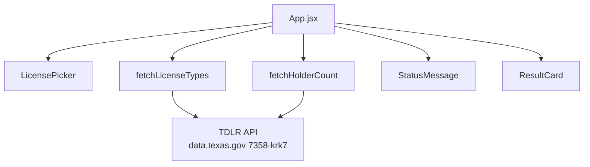

# Texas Second Chance License Navigator (HVAC)

Live demo: https://tx-license-navigator.netlify.app

A one page web app for people with a criminal record who are deciding whether an HVAC trade is worth training for. Pick a Texas TDLR license type (default `A/C Technician`) and a county, and the app shows how many people hold that license with that county listed as their business county. More holders usually means more shops and more hiring nearby. A count is not a job listing.


## Features

- Live TDLR holder count for a license type and county.
- Exact data request link on every result, so the number can be checked in a browser.
- Empty state when the count is 0, shown as an answer, not an error.
- Honest error state with the status code (or "no connection") and a Try again button.
- Keyboard focus moves to the result after each search.

## Data source

TDLR All Licenses on data.texas.gov (Socrata dataset `7358-krk7`). No API key is needed.

```
https://data.texas.gov/resource/7358-krk7.json
```

Example queries (open them in a browser to check the app's numbers):

License types with holder counts:

```
https://data.texas.gov/resource/7358-krk7.json?$select=license_type,count(*) AS holders&$where=license_type IS NOT NULL&$group=license_type&$order=holders DESC&$limit=50
```

A/C Technician holders in Harris County:

```
https://data.texas.gov/resource/7358-krk7.json?$select=count(*) AS holders&$where=license_type='A/C Technician' AND business_county='HARRIS'
```

## Run it

Needs Node 20 or newer.

```
npm install
npm run dev
```

Then open http://localhost:5173.

## Project structure

```
src/
├── App.jsx              holds all state and runs the searches
├── api/
│   └── tdlr.js          all network code: buildTypesUrl, fetchLicenseTypes, buildCountUrl, fetchHolderCount
├── data/
│   └── counties.js      county list (Title Case labels, all caps API values)
└── components/
    ├── SiteHeader.jsx   header and site name
    ├── TrustNote.jsx    "counts only" promise
    ├── LicensePicker.jsx license type and county selects, submit button
    ├── StatusMessage.jsx one line status for screen readers
    ├── ResultCard.jsx   idle, loading, success, empty, and error panels
    └── SourceNote.jsx   dataset link and "not legal advice" note
```

## How it works



## React hooks

Only `App.jsx` uses hooks. The components get everything through props.

- `useState` holds the license type list, the picks, the field error, the status, the error code, the result, and the last search.
- `useEffect` loads the license type list once on page load, and moves focus to the result heading after a search finishes.
- `useCallback` keeps `loadTypes` the same function between renders, so the load effect runs once and Try again can reuse it.
- `useRef` holds `resultHeadingRef`, the result heading that receives focus.

## Privacy

Counts only. Every query uses only `license_type`, `business_county`, and `count(*)`. The app never requests, stores, logs, or shows names, addresses, phone numbers, license numbers, or any personal license record.

## Stack

React, Vite, and Tailwind CSS. The browser calls the public Socrata API directly. There is no server, database, or API key.

General information, not legal advice.

## License

MIT. See [LICENSE](LICENSE).
